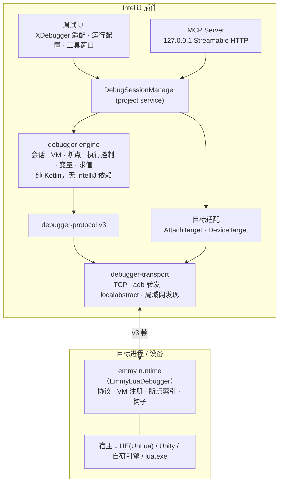
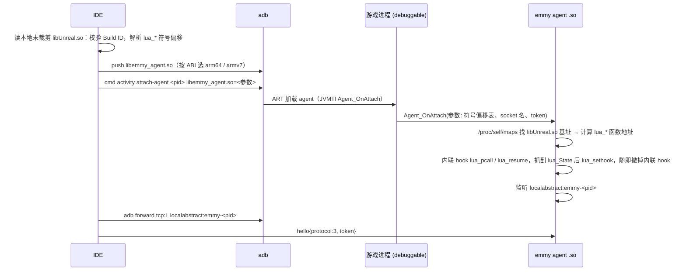

# EmmyLua 调试插件重构设计：附加调试 + 真机调试 + MCP

> 日期：2026-11-16
> 状态：草案，待评审（本轮只出设计，不改代码）
> 范围：IntelliJ-EmmyLua 插件的调试部分、`EmmyLuaDebugger` 原生端（将并入本仓库 `native/`）；真机调试首期只支持 Android
> 已确认的前提：
> 1. 语言支持（补全、跳转、检查、格式化等）保留，只精简调试部分。
> 2. 调试只保留两种场景：**附加调试**（本机进程）和**真机调试**（首期只做 Android 设备上的游戏）。
> 3. 现有 `emmy-debug` CLI 删除，改为 **MCP Server** 给 Agent 用。
> 4. 不需要兼容旧架构；有更高性能的新架构就直接换。
> 5. MCP 支持一键写入当前项目的版本管理根目录；没装时弹窗提示是否安装。
> 6. EmmyLuaDebugger 并入本仓库，不再作为子模块，也不迁到 UEKit。
> 7. 游戏包里不能加入任何调试代码或插件；真机调试走运行时注入，首期只支持 Android。
> 8. EmmyLuaDebugger 并入后原仓库删除，只保留一个项目；开发在 `dev` 分支，验收后合入 `main`。
> 9. 改动大的部分可以重写；评估结论见 [12.1](#121-重写还是重构评估结论)。

---

## 目录

1. [结论摘要](#1-结论摘要)
2. [现状评估](#2-现状评估)
3. [目标架构](#3-目标架构)
4. [新调试协议 v3](#4-新调试协议-v3)
5. [原生端（EmmyLuaDebugger）重构与性能](#5-原生端emmyluadebugger重构与性能)
6. [MCP Server 设计（替换 CLI）](#6-mcp-server-设计替换-cli)
7. [真机调试](#7-真机调试)
8. [EmmyLuaDebugger 是否保留、迁移到哪里](#8-emmyluadebugger-是否保留迁移到哪里)
9. [精简：删除清单](#9-精简删除清单)
10. [UI 重新设计](#10-ui-重新设计)
11. [其他优化与扩展点](#11-其他优化与扩展点)
12. [实施计划](#12-实施计划)
13. [风险与待定事项](#13-风险与待定事项)

---

## 1. 结论摘要

**现有项目能用，但结构不合理的地方集中在调试部分。** 9 月那轮重构把多 VM 模型、`sourceIdentity`、v2 消息、调试会话状态机做对了方向，`modules/debugger-core` 也有单测；问题在于这些好东西被三套调试器（Emmy 启动/远程、Emmy Attach、LuaPanda）、两代协议（v1 + v2 Envelope）和一套很重的 CLI（授权 / 租约 / Probe）缠在一起，最后都压在一个 2053 行的 `EmmyDebugProcessBase` 上。原生端的行钩子热路径上每执行一行 Lua 都要加锁并**复制一份断点行号 `std::set`**，这是运行时变慢的主要原因。

**建议的方向：**

| 方面 | 现在 | 改成 |
| --- | --- | --- |
| 调试方式 | Emmy 启动(TCP/管道 4 种)、Emmy Attach、LuaPanda | **附加**（本机注入）+ **真机**（设备内嵌 runtime，经 USB/局域网连） |
| IDE 侧结构 | `EmmyDebugProcessBase` 一个类管连接、握手、断点、控制、求值、CLI、重连 | 与 IntelliJ 无关的 `debugger-engine`（纯 Kotlin，可单测）+ 薄的 XDebugger 适配层 + MCP 适配层 |
| 协议 | v1（两行文本）+ v2 Envelope 并存 | **v3**：长度前缀帧、请求/响应带 id、能力协商、按需拉取变量，不再兼容 v1/v2 |
| 原生热路径 | 每行加锁 + 复制 set + 常开 LINE/CALL/RET 钩子 | 无锁不可变断点索引 + 按函数开关行钩子；无断点时近乎零开销 |
| Agent 接入 | 独立 `emmy-debug` CLI + 授权/租约 | IDE 内置 **MCP Server**（127.0.0.1 HTTP），一键写入项目 `.mcp.json` 等配置 |
| 真机 | 只有文档说"可以自己编进去" | **真机附加**：Android 运行时注入（`attach-agent` + 本地符号），包体零改动；iOS 首期不支持；内嵌模式作为可选项 |
| 原生库 | 子模块 + 二进制提交在 `src/main/resources/debugger`（约 11 MB） | 源码并入 `native/`，同一次 CI 编译后打进插件包 |

**功能不缩水、性能有量化目标。** 逐项对照见 [2.5](#25-功能完整性改造后不缩水)：除命名管道和纯 Lua 调试器两项（给出理由和兜底），现有能力全部保留，并新增修改变量、出错即停、协程视图、Agent 附加/连设备等。性能目标与验收方法见 [5.3](#53-性能目标与验收)：不下断点时游戏侧开销目标 ≤ 1.05 倍，USB 下命中断点到显示变量 ≤ 100 ms。

**EmmyLuaDebugger 结论：必须保留，必须重构（性能和移动端），并入本仓库 `native/` 目录（已确认）。** 它是引擎无关的调试 runtime（附加注入、5 个 Lua 版本、非 UE 宿主都靠它）；并入后协议两端可以在一个 PR 里同时改。真机调试**不往游戏包里加任何东西**：Android 用系统的 `attach-agent` 在运行时把调试 agent 注入可调试的开发包进程，配合本地未裁剪的 `libUnreal.so` 符号定位 Lua 函数，和 PC 附加一样做到零改动；iOS 在不改包的前提下没有可靠方案，首期不支持（已确认）。详见[第 8 节](#8-emmyluadebugger-是否保留迁移到哪里)。

---

## 2. 现状评估

### 2.1 现有组成

| 部分 | 位置 | 规模 | 说明 |
| --- | --- | --- | --- |
| 语言支持 | `src/main/java/.../lua/{psi,editor,codeInsight,...}`、`gen/` | 占代码大头 | 保留，本次不动 |
| 调试 IDE 层 | `src/main/java/.../lua/debugger/**` | ~13,000 行 | Emmy、Attach、LuaPanda、CLI 网关全在主模块里 |
| 调试模块 | `modules/debugger-{core,transport,emmy-protocol,cli-protocol,luapanda-protocol}` | ~4,000 行 | 状态机、事件循环、请求注册、协议编解码 |
| CLI 工具 | `tools/emmy-debug` | ~740 行 | 独立分发的命令行 |
| 原生资源 | `src/main/resources/debugger/emmy/**` | ~11 MB | dll/exe/so/dylib 直接提交 |
| 原生端 | 子模块 `EmmyLuaDebugger` | ~20,000 行 C++ | `emmy_debugger` 核心、`emmy_core` Lua 模块、`emmy_hook` + `emmy_tool` Windows 注入 |

### 2.2 做得好的，要保留

- **多 VM 一等模型**：`VmRegistry`、`vmId` / `pauseId` / `sourceEpoch` 贯穿所有暂停引用，PIE 重启、热重载后旧引用能可靠失效。
- **`sourceIdentity`**：按宿主实际加载的字节做 hash，热更新后的代码不会被当成本地文件。真机调试尤其需要。
- **Host API**（`Emmy_RegisterLuaVm` 等）：宿主显式上报 VM 生命周期，不全靠 hook 猜。
- **`debugger-core` 的状态机 / 事件循环 / 请求注册**，有单测；**协议 golden test**。
- **受限求值（VALUE_PATH）**：Agent 默认不能执行任意 Lua，这个安全默认值要保留到 MCP。
- **有界快照**（depth / nodes / bytes / deadline），避免一次展开巨型 table 卡死游戏。
- **附加断开后目标不再卡死在暂停**（原生端最近的修复）。

### 2.3 不合理的地方

**架构层面**

1. **上帝类**。`EmmyDebugProcessBase.kt` 2053 行，同时负责：传输候选与重连、v1/v2 双握手、VM 快照请求与重试、XDebugger 断点、CLI 断点与 Probe 合并（`sendCompositeBreakpointSnapshotLegacy`）、单步/运行到光标、求值、CLI 后端接口 `EmmyDebugBackend` 的 10 个方法、内联值快照、授权。CLI 的概念（`cliBreakpoints`、`cliProbes`、`registerCliTarget`、`autoAuthorizeCliClients`）直接写在调试核心里，删 CLI 要动核心。
2. **IDE 层和引擎没分开**。调试逻辑在主插件模块里，依赖 `XDebugSession`，脱离 IDE 无法测试；`modules/debugger-core` 只抽出了状态机这类通用件，真正的会话逻辑没进去。
3. **两代协议并存**。v1 的 0–17 号消息和 v2 Envelope 同时存在，每条路径都有"legacy 分支"，代码量和测试量翻倍。
4. **三套调试器重复**。LuaPanda（`LuaPandaDebugProcess` 989 行 + `LuaPandaTransporter` 792 行 + 协议模块 + 版本检查 + 通知组）与 Emmy 功能重叠，且协议能力更弱。
5. **CLI 过重**。授权菜单、客户端标识、控制租约（含心跳和 TTL）、Probe 代际、实例发现文件、token 文件、8 种退出码；Agent 还得学会一套命令行语法、自己拼 `--target --vm --pause --frame --lease --client`。MCP 天然解决"工具发现 + 参数 schema + 会话"这些问题，这些机制大部分可以去掉。
6. **附加调试的 UE 特化写死在通用代码里**（`UEProcessType`、`UEProcessListRenderer`、`filterUEProcesses`）。
7. **运行配置手写持久化**（`JDOMExternalizerUtil` 逐字段读写 + 手写 schema 版本），设置面板一部分是 Java Swing 表单（`EmmyDebugSettingsPanel.java` 362 行）。

**性能层面（原生端，详见第 5 节）**

8. 行钩子每次触发：`luaThreadMtx` 加锁换 vector、`GetLineSet()` 在锁内**按值返回整个 `std::set<int>`**（每执行一行 Lua 就一次堆分配）、`hookStateMtx` 加锁、`evalMtx` 加锁；`EmmyFacade::Hook` 每次还要 `debuggerMtx` 加锁查 map。
9. 钩子掩码在运行态常开 `LINE | CALL | RET`，没有断点、不在单步时也是满额开销。
10. 断点命中时 `GetBreakpoints()` 复制整个断点数组，再逐个做模糊路径匹配。
11. 传输格式是"命令号一行 + JSON 一行"，大 payload 需要整体扫描换行；变量快照在暂停时偏向一次性推送。

**仓库卫生**

12. `bin/main/**`（旧源码副本）被提交了，尽管 `.gitignore` 里有 `bin/`。
13. `bunch/`（旧的多版本分支工具 + 15 个 jar）和根目录 `.bunch`，当前构建已不用。
14. `.superpowers/`（过程记录）、根目录 `protocol_analysis_report.md`（LuaPanda 分析）、`design/emmy.ai`（设计源文件）、部分 `.idea/` 文件在仓库里。
15. 原生二进制直接提交在插件仓库，和子模块源码版本没有可校验的对应关系。
16. 子模块地址是 SSH（`git@github.com:...`），匿名 / CI 克隆会失败，这也是并仓的理由之一（见 8.3）。
17. README 已过时（指向 tangzx 的 Releases、LuaPanda 安装方式）。
18. `org.eclipse.egit.github.core`（2014 年的库）只为错误上报使用。

### 2.4 评估结论

| 问题 | 是否必须改 | 理由 |
| --- | --- | --- |
| 拆上帝类 / 引擎与 IDE 分层 | 必须 | MCP 和 UI 要共用同一个会话，不拆就只能再往 `EmmyDebugProcessBase` 里加第三套接口 |
| 删 LuaPanda、管道模式、CLI | 必须 | 用户已明确只保留两种场景；这三块占调试代码约 40% |
| 协议 v3 | 强烈建议 | 真机链路（Wi-Fi、USB 转发）对延迟和包大小敏感；且可以借机删掉 v1/v2 双路径 |
| 原生热路径优化 | 必须 | 真机 CPU 更弱，现在的每行开销在手机上会直接表现为掉帧 |
| 仓库卫生 | 建议 | 成本低，顺手做 |

### 2.5 功能完整性：改造后不缩水

精简的是"实现方式"（三套调试器、两代协议、CLI），不是"能力"。下表逐项列出现在各入口提供的能力，以及改造后由谁承接。✅ 表示已有并保留，🆕 表示新增，⚠️ 表示有取舍。

**调试基础能力**

| 能力 | 现在 | 改造后 | 说明 |
| --- | --- | --- | --- |
| 行断点 | Emmy / LuaPanda | ✅ | |
| 条件断点 | Emmy / LuaPanda | ✅ 改为 runtime 侧预编译执行 | 弱网下不再往返 IDE |
| 日志断点（不停） | Emmy | ✅ | |
| 命中次数条件 | Emmy（`hitCondition`） | ✅ | |
| 临时断点 / 运行到光标 | Emmy | ✅ | 最近刚修过 Run to Position 的顺序和暂停身份问题，迁移时保留这两个用例 |
| 单步进入 / 跳过 / 跳出 | Emmy / LuaPanda | ✅ | 新热路径下按需开钩子，见 5.2 |
| 暂停（Break All） | Emmy / LuaPanda | ✅ | 无断点时靠 COUNT 钩子响应，最长延迟见 5.4 |
| 启动即停（stopOnEntry） | LuaPanda | ✅ 用 runtime 的 `waitIDE` + `breakHere` 承接 | 运行配置里加"连接后在第一行暂停"选项 |
| 调用栈 | 全部 | ✅ 分页加载 | |
| 局部变量 / upvalue / 全局 | 全部 | ✅ 按需展开 | |
| 表达式求值 | Emmy（任意 Lua） | ✅ | IDE 内仍可任意求值；Agent 默认只读路径 |
| 求值时代码补全 | Emmy（`LuaDebuggerEditorsProvider`） | ✅ | 依赖语言支持，保留 |
| 修改变量值 | 无 | 🆕 `setVariable` | 现在都不支持，新协议补上 |
| 监视表达式 | IDE 通用能力 | ✅ + 🆕 按项目持久化 | |
| 内联变量值 | ✅ `LuaEditorLinePainter` | ✅ | |
| 控制台堆栈跳转 | ✅ `LuaTracebackFilter` | ✅ | |
| 自定义类型显示（UE 的 FVector、TArray 等） | Emmy `emmyHelper_ue.lua` | ✅ ⚠️ 改为通过协议下发 helper 源码 | 现在 `InitReq` 传的是**本机磁盘路径**，真机上不存在；v3 在握手后把 helper 脚本内容发给 runtime 加载 |
| 多 VM / PIE 重启 / 热重载后失效 | Emmy v2 | ✅ | |
| `sourceIdentity` 内容校验 | Emmy v2 | ✅ | 真机热更新场景更重要 |
| 协程 | Emmy 自动跟随当前协程 | ✅ + 🆕 协程列表视图 | |
| 出错即停 | 无 | 🆕 | 见第 11 节 |
| 断线重连 + 断点重发 | Emmy | ✅ | 真机 App 切后台必需 |

**连接方式**

| 方式 | 现在 | 改造后 |
| --- | --- | --- |
| Windows 进程附加（注入） | Emmy Attach | ✅，并进入 IDE 原生 Attach to Process 列表 |
| IDE 连 runtime（TCP） | Emmy NEW `tcp-client` | ✅ 并入"设备/远程调试" |
| runtime 连 IDE（TCP） | Emmy NEW `tcp-server` | ✅ 并入"设备/远程调试"（连接方向选项） |
| 命名管道 | Emmy NEW `pipe-*` | ⚠️ 删除：只能本机用，TCP 回环完全覆盖，且多一个原生依赖 |
| 纯 Lua 调试器（无需原生编译） | LuaPanda | ⚠️ 删除。代价：宿主**无法编译原生库**时就没法调试。缓解：这种情况很少（Unity/UE/自研引擎都能链接 C 库）；若确有需要，P7 之后可以用 Lua 写一个实现 v3 子集的 runtime 兜底，复用同一套 IDE 和 MCP |
| Android 真机附加（包体零改动） | 无 | 🆕 见 7.2 |
| iOS 真机 | 无 | ⚠️ 首期不支持（不改包无可靠方案），见 7.3 |

**Agent 能力（CLI → MCP）**

| 能力 | CLI | MCP |
| --- | --- | --- |
| 列目标 / VM | ✅ | ✅ |
| 栈 / 作用域 / 变量 | ✅ | ✅ 且返回带源码片段的可读文本 |
| 受限求值（路径） | ✅ | ✅ 默认模式 |
| 任意 Lua 求值 | ✗ | 🆕 设置开启后可用 |
| Probe（采集不停） | ✅ | ✅ 变成断点属性 |
| 断点增删 | ✅ | ✅ 且在编辑器里可见 |
| 继续 / 单步 / 暂停 | ✅（需租约） | ✅ 单步后自动等待并返回新位置 |
| 等待事件 | `wait --cursor` | `wait_for_pause` |
| 附加进程 / 连设备 | ✗（只能操作已有会话） | 🆕 需用户确认 |
| 读调试输出 / 错误 | ✗ | 🆕 |

结论：除"命名管道"和"纯 Lua 调试器"两项外，所有能力保留或增强；这两项的取舍理由和兜底方案如上。

---

## 3. 目标架构

### 3.1 分层



要点：

- **`debugger-engine` 是唯一的"真相"**。断点、VM 列表、暂停状态、变量引用都存在这里；XDebugger UI 和 MCP 都只是它的客户端，看到的是同一份状态。UI 里点"继续"，MCP 的 `wait_for_pause` 会收到；Agent 下的断点也会出现在编辑器里。
- **不再有"CLI 断点 / IDE 断点合并"**。Agent 的断点就是普通断点，带一个 `origin = agent` 标记（UI 里用不同图标显示，可一键清除）。Probe 变成断点的一个属性（`capture` + `autoContinue`），不是单独一套机制。
- **目标适配只负责"怎么连上"**。附加 = 注入 + 连 PID 派生端口；真机 = 选设备 + 建转发 + 连端口。连上之后的一切走同一个引擎。

### 3.2 模块划分（Gradle）

| 模块 | 依赖 | 内容 |
| --- | --- | --- |
| `modules/debugger-protocol` | 无 | v3 帧编解码、消息 DTO、能力位；合并现在的 `debugger-emmy-protocol`，删 v1/v2 |
| `modules/debugger-transport` | protocol | `Connection` 接口；TCP 实现；`AdbForwarder`、`UsbmuxConnector`、`LanDiscovery` |
| `modules/debugger-engine` | protocol, transport | 由现 `debugger-core` 扩展而来：`DebugSession`、`VmRegistry`、`BreakpointStore`、`ExecutionController`、`VariableService`、`EventBus` |
| `modules/debugger-mcp` | engine | MCP 工具定义、参数 schema、结果格式化、权限策略；不依赖 IntelliJ，可用假 engine 单测 |
| 主插件 `debugger/` 包 | 以上全部 + IntelliJ | XDebugger 适配、运行配置、UI、MCP HTTP 宿主、MCP 安装器 |

### 3.3 `debugger-engine` 内部

`EmmyDebugProcessBase` 拆成以下几个对象，每个都可单测：

| 组件 | 职责 | 来源 |
| --- | --- | --- |
| `ConnectionManager` | 建连、握手、能力协商、心跳、断线重连 | 从 Base 拆出 |
| `VmRegistry` | VM 生命周期、`sourceEpoch`、显示名 | 现有，移入 engine |
| `BreakpointStore` | 所有断点（IDE/Agent），按 revision 增量下发 | 合并现 `breakpoints` + `cliBreakpoints` + `BreakpointComposer` + `BreakpointRepository` |
| `ExecutionController` | 继续 / 暂停 / 单步 / 运行到行，按 vmId/threadId 路由 | 从 Base 拆出 |
| `PauseStore` | 暂停快照、栈帧、失效规则 | 现 `PauseSnapshotStore` |
| `VariableService` | 按需拉取变量（分页）、引用句柄、求值 | 现 `EmmyEvaluator` + `RestrictedValuePathEvaluator` |
| `SourceMapper` | chunkName ↔ 本地文件映射、`sourceIdentity` 校验 | 现 `SourceMappingService` + `SourceIdentity` |
| `EventBus` | `paused / resumed / vmAdded / vmClosed / output / breakpointVerified` 等事件，供 UI 和 MCP 订阅 | 现 `DebugSessionEventLoop` |

线程模型：每个会话一个单线程事件循环（沿用 `DebugSessionEventLoop`），所有状态只在这个线程修改；对外 API 返回 `CompletableFuture`/挂起函数。UI 和 MCP 调用都是投递消息，不存在两个入口同时改状态的问题，现在的 `cliStateGeneration`、`cliBreakpointMutationPending` 这类并发补丁可以去掉。

---

## 4. 新调试协议 v3

不兼容 v1/v2。旧版本 runtime 连上来时握手失败，提示升级 runtime。

### 4.1 帧格式

```
+---------+---------+-----------+------------------+
| magic 2 | type 1  | length 4  | payload (length) |
+---------+---------+-----------+------------------+
magic = 0xE3 0x01   type: 1=request 2=response 3=event
```

- **长度前缀**，不再按换行切分；接收方按长度一次读完，不扫描。
- **payload 编码**：默认 JSON（便于调试和抓包）；握手时协商 `cbor` 能力后切换 CBOR（体积约为 JSON 的 50–70%，解析更快）。两端都用同一套 DTO，切换编码不改上层。
- **request/response 带 `id`**，响应与请求一一对应，取代现在靠 `cmd` 号 + 回调猜对应关系；超时、取消（`cancel {id}`）有统一语义。

### 4.2 握手与能力

```text
IDE → runtime: hello { protocol: 3, client: "intellij", token?, wantCaps: [...] }
runtime → IDE: welcome { protocol: 3, runtimeVersion, luaVersion, platform, arch,
                          process: {pid, name}, caps: ["cbor","valuePath","luaEval",
                          "hostApi","sourceHash","logpoint","hitCount","runToLine"], sessionId }
```

握手完成后 IDE 发送 `loadHelpers {scripts:[{name, source}]}`，把 `emmyHelper.lua` / `emmyHelper_ue.lua` 等类型显示脚本的**内容**发给 runtime 加载（现在传的是本机磁盘路径，真机上不存在）。

能力位决定 UI 和 MCP 暴露哪些功能（例如没有 `luaEval` 时 MCP 不提供任意表达式求值）。

### 4.3 按需取数据

现在暂停时偏向一次推完整栈和变量。v3 改成：

1. `paused` 事件只带 `vmId / pauseId / threadId / reason / 顶层帧位置`。
2. 栈：`stackTrace {pauseId, start, count}` 分页。
3. 作用域：`scopes {frameId}` → locals / upvalues / globals 的 `ref`。
4. 变量：`variables {ref, start, count}` 分页；大 table 只返回前 N 项 + `total`。
5. 求值：`evaluate {frameId, expr, mode: valuePath|lua}`。

IDE 只取看得见的部分，Wi-Fi 下暂停响应从"等整包"变成"先显示顶层帧"。

### 4.4 断点增量

`setBreakpoints {revision, upserts:[...], removes:[...]}`，runtime 回 `breakpointsApplied {revision, verified:[...]}`。断点字段：`id, source{path, chunkName?, sha256?}, line, condition?, hitCondition?, logMessage?, capture?[], autoContinue?, vmId?`。

---

## 5. 原生端（EmmyLuaDebugger）重构与性能

### 5.1 热路径现状（`emmy_debugger.cpp`）

每执行一行 Lua，`Debugger::Hook` 会：

```text
EmmyFacade::Hook         → GetDebugger(L)：debuggerMtx 加锁 + map 查找
Debugger::Hook           → evalMtx 加锁取 pendingAction
                         → luaThreadMtx 加锁 swap executors
FindBreakPoint(ar)       → manager->GetLineSet()：breakpointsMtx 加锁 + 复制 std::set<int>
                         → hookStateMtx 加锁取 hookState
```

运行态钩子掩码常开 `LUA_MASKCALL | LUA_MASKLINE | LUA_MASKRET`（`emmy_facade.cpp:77/80/1316`）。

### 5.2 新热路径

1. **按函数开关行钩子**（核心优化）
   - 运行态（无单步）只开 `CALL | RET`。
   - CALL 时用 `ar->source` 指针（Lua 5.2+ 字符串驻留，同一 chunk 指针稳定）查**每 VM 的 source 缓存**：这个 chunk 有没有断点。有，才给当前协程打开 `LINE`；返回到无断点函数时关掉。
   - 没有任何断点时：掩码为 0，只保留一个 `COUNT` 钩子（例如每 100 万条指令）用于响应"暂停"请求。**零断点 = 近乎零开销**。
   - 单步时按需开 `LINE`（step in）或 `LINE | CALL | RET`（over/out 的深度跟踪）。
2. **无锁不可变断点索引**：断点更新时在网络线程构建新的 `BreakpointIndex`（`unordered_map<sourceKey, flat_set<line>>` + 条件预编译），用 `std::atomic<std::shared_ptr>` 或原子指针 + 代际回收发布；钩子线程只做一次原子读。
3. **chunk 解析缓存**：`chunkName → sourceKey` 的路径匹配结果按 `(source 指针, 断点 revision)` 缓存，命中后不再做模糊匹配字符串运算。
4. **待执行动作用原子标志**：`pendingAction`、`executors` 非空用 `atomic<uint32_t>` 位标志判断，只有置位时才加锁。
5. **`lua_State → Debugger` 查找**：把 `Debugger*` 存进 `lua_getextraspace`（5.3+）或每 VM 一个小的开放寻址表，去掉全局 map 锁。
6. **条件断点**：条件编译为受限表达式 AST（沿用 `restricted_eval`），命中时求值；不再每次 `luaL_loadstring`。

预期：无断点时的 Lua 执行开销从"每行若干次加锁 + 一次分配"降到接近 0；有断点文件内的函数才有行钩子开销。需要用 `tests/` 下的基准（新增 `bench_hook`：100 万次循环、fib(25)、table 遍历）在 Windows x64 和 Android arm64 各测一次，作为验收数据。

### 5.3 性能目标与验收

下面的数字是**目标**，不是实测值。P2 第一步先用 `bench_hook` 量出现状作为基线（Windows x64 + 一台中端 Android arm64），再按此表验收。比较对象是"同一程序不挂调试器"的耗时。

**运行时开销（游戏侧，最关键）**

| 场景 | 现在的行为 | 目标 |
| --- | --- | --- |
| 已连接，没有任何断点 | 每行触发钩子 + 多次加锁 + 复制 set | ≤ 1.05 倍（只剩稀疏 COUNT 钩子） |
| 有断点，但当前执行的函数所在文件没有断点 | 同上 | ≤ 1.3 倍（只有 CALL/RET 钩子 + 一次指针查表） |
| 正在有断点的函数里执行 | 同上 + 命中时模糊匹配 | ≤ 2 倍（行钩子 + 无锁 `flat_set` 查行号） |
| 条件断点高频命中（每帧上千次） | 每次回到通用求值路径 | 单次条件判断 ≤ 2 µs（预编译 AST） |
| 未连接 IDE（开发包，runtime 已编入但没人连） | — | 1.00 倍：不挂任何钩子 |
| 内存 | — | runtime 常驻 ≤ 2 MB；每 VM 额外 ≤ 64 KB |

**交互延迟（IDE 侧）**

| 操作 | 目标（USB / 本机） | 目标（局域网 Wi-Fi） |
| --- | --- | --- |
| 命中断点 → 编辑器高亮当前行 | ≤ 50 ms | ≤ 150 ms |
| 暂停后显示顶层帧局部变量 | ≤ 100 ms | ≤ 250 ms |
| 展开一个 1 万项的 table（首页 100 项） | ≤ 100 ms | ≤ 300 ms |
| 单步 | ≤ 50 ms | ≤ 150 ms |
| Break All 生效（无断点、游戏在跑） | ≤ 20 ms（COUNT 间隔按 CPU 自适应） | ≤ 100 ms |
| 修改断点 → runtime 生效 | ≤ 30 ms | ≤ 100 ms |
| MCP `lua_debug_step` 从调用到返回新位置 | ≤ 150 ms | ≤ 300 ms |

**IDE 侧实现要求**

- 所有网络、解码在后台线程；EDT 上只做 UI 更新，任何调试操作都不允许阻塞 EDT（现在部分求值路径有同步等待，迁移时逐个改成异步）。
- 变量树、栈全部分页；内联值只请求编辑器可见行涉及的变量名。
- 帧解码零拷贝读取（`ByteBuffer` 切片），CBOR 用流式解码。

**手段与依据**

| 手段 | 为什么能变快 |
| --- | --- |
| 按函数开关行钩子 | Lua 的行钩子每条语句都要从 VM 切到 C 回调，是最大的固定开销；只在需要的函数里开，绝大多数代码完全不付这笔钱 |
| 无锁不可变断点索引 | 钩子线程只做一次原子读和一次哈希查找，去掉每行多次加锁和一次堆分配 |
| `source` 指针缓存 | 同一函数的 `source` 字符串指针不变，路径匹配结果算一次复用，不在热路径做字符串比较 |
| 长度前缀帧 + CBOR + 按需拉取 | 少传、少扫描、少解析；Wi-Fi 下最明显 |
| runtime 侧执行条件 / 日志断点 | 不再每次命中都往返 IDE |

**验收方式**：`bench_hook` 和 IDE 侧的假 runtime 延迟测试进 CI，任一指标比基线退步超过 10% 直接失败；真机数字在 P5 结束时用 Android 中端机和低端机各测一轮写进验证文档。

### 5.4 其他原生端改动

| 项 | 改动 |
| --- | --- |
| 核心拆分 | 拆出 `emmy_debugger_core`：钩子状态机、断点索引、变量读取、受限求值、协议编解码，不含网络 / 线程 / 注入，宿主通过小接口提供 IO；`emmy_core`、PC 附加、Android 真机附加都基于它 |
| C++ 标准 | C++11 → C++17（`std::optional`、`string_view`、`shared_mutex`、结构化绑定），清理手写锁宏 |
| 协议 | 实现 v3；删除 v1 消息、v2 Envelope、管道传输（`pipeline_*_transporter.cpp`） |
| `EmmyFacade` | 1327 行单例拆成 `Session`（连接 + 协议）、`VmHub`（VM 注册）、`HookDispatcher`；单例只留 C ABI 入口 |
| 网络 | 保留 libuv（各平台都能编，已经在用）；网络线程只收发帧，解析后投递到每 VM 的命令队列 |
| 钩子共存 | 新增 `HookMux`：一个 `lua_State` 只能挂一个钩子，提供 C ABI `Emmy_HookMux_Register(callback, mask)` 让宿主其他工具（如项目自带的性能统计、UELink 的快照点 / 采样）共享，代替各自"记住上一个钩子再转发"的做法 |
| 平台 | 新增 Android（NDK, arm64-v8a / armeabi-v7a / x86_64）（runtime 与真机附加 agent）、Linux arm64 构建；iOS 暂不做 |
| 产物 | 本仓库 CI 编译各平台 runtime，PC 端二进制直接打进插件包；Android agent / Unity 包作为 Release 附件 `emmy-runtime-<ver>-<platform>.zip` + `SHA256SUMS` 发布；仓库不再提交二进制 |
| 安全 | 局域网监听强制 token（配对码）；`EMMY_DEBUG_ENABLED` 编译宏，发布包不编入 |

---

## 6. MCP Server 设计（替换 CLI）

### 6.1 承载方式

| 方案 | 说明 | 结论 |
| --- | --- | --- |
| A. 插件内嵌 MCP Server（Streamable HTTP，`127.0.0.1`） | 插件自己起 HTTP 端点，任何 MCP 客户端都能连 | **采用** |
| B. 贡献工具到 JetBrains 内置 MCP Server（2025.2+） | 复用 IDE 的 MCP 端点 | 作为可选附加：检测到内置 MCP Server 插件时同时注册一份，同一套工具实现 |
| C. stdio 桥接进程 | 客户端启动一个小程序再连 IDE | 不采用：要在项目配置里写本机 Java 路径，团队共享的配置文件没法用 |

选 A 的原因：端点地址稳定，可以写进项目根目录的配置文件给全组用；不依赖 IDE 版本；我们能完全控制会话和权限。

端点：`http://127.0.0.1:<port>/mcp`，默认端口 `9330`，可在设置里改；被占用时顺延并提示更新配置。只绑定回环地址，校验 `Origin` / `Host` 头（防 DNS rebinding，MCP 规范要求）。

### 6.2 权限模型（代替授权菜单 + 租约）

| 级别 | 工具 | 默认 |
| --- | --- | --- |
| 只读 | 列会话、栈、变量、断点、输出、`wait_for_pause` | 允许 |
| 控制 | 下/删断点、继续、单步、暂停、运行到行、Probe | 每个调试会话**第一次**控制时 IDE 弹通知「Agent 请求控制调试会话 X：允许 / 本次会话总是允许 / 拒绝」 |
| 任意求值 | `evaluate` 的 `mode=lua`（执行任意 Lua） | 关闭；设置里单独打开 |
| 启动/附加 | `attach_process`、`attach_device` | 每次在 IDE 里弹确认 |

- 原 CLI 的 VALUE_PATH 受限求值作为 `evaluate` 的默认模式保留。
- 原"租约"去掉：引擎单线程处理所有命令，UI 和 Agent 不会冲突；UI 操作优先，Agent 正在 `wait_for_pause` 时用户手动继续，Agent 会收到 `resumed (by user)`。
- 调试工具窗口里有"Agent"页，实时显示 Agent 的每一次调用，可一键"撤销 Agent 控制"。

### 6.3 工具清单

命名统一用 `lua_debug_` 前缀，避免和 Agent 面板已有的 `ue_*`、UELink 的 `lua.*` 操作混淆。

**会话与目标**

| 工具 | 参数 | 返回 |
| --- | --- | --- |
| `lua_debug_list_sessions` | — | 会话列表：id、类型（attach/device）、目标、状态、VM 数、是否暂停 |
| `lua_debug_list_targets` | `kind?: process\|device` | 可附加的本机进程（自动识别加载了 Lua 的进程）和已发现的设备 |
| `lua_debug_attach_process` | `pid` 或 `name`, `config?` | 新会话 id（需用户确认） |
| `lua_debug_attach_device` | `deviceId`, `package` 或 `pid`, `config?` | Android 真机附加，新会话 id（需用户确认） |
| `lua_debug_stop_session` | `sessionId` | — |
| `lua_debug_list_vms` | `sessionId` | VM 列表：vmId、显示名、状态、sourceEpoch |

**断点**

| 工具 | 参数 |
| --- | --- |
| `lua_debug_set_breakpoint` | `file, line, condition?, hitCount?, logMessage?, capture?[], autoContinue?, vmId?` |
| `lua_debug_remove_breakpoint` | `breakpointId` 或 `file+line`，`all?`（只删 Agent 下的） |
| `lua_debug_list_breakpoints` | `origin?: ide\|agent\|all` → 列表 + 是否已验证 |

`capture + autoContinue` 就是原 CLI 的 Probe：命中时采集变量，不停下游戏；采集结果进事件流，用 `wait_for_pause` 或 `get_probe_hits` 读。

**执行控制**

| 工具 | 参数 | 说明 |
| --- | --- | --- |
| `lua_debug_continue` | `sessionId, vmId?` | |
| `lua_debug_pause` | `sessionId, vmId?` | |
| `lua_debug_step` | `sessionId, kind: over\|into\|out` | 执行后自动等待下一次暂停（默认 10 秒），直接返回新位置和当前帧局部变量摘要，省掉 Agent 再调一次 |
| `lua_debug_run_to_line` | `sessionId, file, line` | 同上 |
| `lua_debug_wait_for_pause` | `sessionId?, timeoutMs (≤120000)` | 阻塞到下一次暂停 / Probe 命中 / 会话结束；**Agent 调试循环的核心工具** |

**查看**

| 工具 | 参数 | 返回 |
| --- | --- | --- |
| `lua_debug_get_stack` | `sessionId, vmId?, start?, count?` | 帧列表：frameId、函数、本地文件:行、chunkName、源码片段（当前行 ±3） |
| `lua_debug_get_variables` | `frameId, scope?: locals\|upvalues\|globals, path?, ref?, depth?(默认 1), limit?` | 变量树（有界），每项带 `ref` 可继续展开 |
| `lua_debug_evaluate` | `frameId, expression, mode?: valuePath\|lua` | 值 + 类型 + 可展开 ref |
| `lua_debug_get_output` | `sessionId, sinceSeq?, limit?` | 调试器日志、`print` 输出、Lua 错误 |
| `lua_debug_get_probe_hits` | `breakpointId?, sinceSeq?` | Probe 采集记录 |

### 6.4 返回值设计

- 同时返回 `structuredContent`（JSON，给程序用）和简洁文本（给模型读），文本示例：

  ```text
  已暂停 · VM "GameLua"(vm-2) · 原因: 断点 #3
  #0 BagPanel:OnItemClick  Content/Script/UI/BagPanel.lua:120
     118 |   local item = self.items[index]
     119 |   if not item then return end
  >  120 |   self:ShowDetail(item)
  locals: self=<BagPanel 0x1a2b>, index=7, item={id=1003, count=2, …}
  ```

- 所有引用（`frameId`、`ref`）都绑定 `pauseId`，过期时返回明确错误和恢复提示：「这个栈帧已失效（游戏已继续运行）。先调用 lua_debug_wait_for_pause 或 lua_debug_get_stack 获取新的 frameId。」
- 大小预算：单次返回默认 ≤ 16 KB 文本，超出截断并标明 `truncated` 和如何继续取。

### 6.5 MCP 安装到项目（用户新增需求）

**写到哪里**：当前项目的**版本管理根目录**（`ProjectLevelVcsManager.getAllVersionedRoots()`；多个根时让用户选，默认含 `.idea` 的那个；没有 VCS 时用项目根）。

**写哪些文件**（按检测到的客户端勾选，默认勾选已存在对应目录的）：

| 客户端 | 文件 | 写入内容 |
| --- | --- | --- |
| Claude Code | `<root>/.mcp.json` | `{"mcpServers": {"emmylua-debug": {"type": "http", "url": "http://127.0.0.1:9330/mcp"}}}` |
| Cursor | `<root>/.cursor/mcp.json` | `{"mcpServers": {"emmylua-debug": {"url": "http://127.0.0.1:9330/mcp"}}}` |
| VS Code / Copilot | `<root>/.vscode/mcp.json` | `{"servers": {"emmylua-debug": {"type": "http", "url": "..."}}}` |
| Gemini CLI | `<root>/.gemini/settings.json` | `{"mcpServers": {"emmylua-debug": {"httpUrl": "..."}}}` |
| Codex | 用户级 `~/.codex/config.toml` | 只在用户勾选时写，单独提示"这是全局配置" |

各客户端的配置格式以实现时的官方文档为准，安装器为每个客户端写一个小的 `McpClientConfigWriter`，便于跟进格式变化。

**写入规则**

- **合并不覆盖**：读取已有 JSON，只增改 `emmylua-debug` 这一项，保留其他 server 和格式（缩进跟随原文件）。解析失败时不写，提示用户手动处理并给出要粘贴的片段。
- **不写密钥**：配置里只有本机回环地址，没有 token，可以安全提交到仓库；安全靠"只听 127.0.0.1 + Origin 校验 + IDE 内确认控制"。
- 写完后用 VCS 的"新文件"提示让用户决定是否加入版本管理（不自动 `git add`）。
- 端口改了以后，安装器检测到已写入的地址和当前端口不一致，提示一键更新。

**没安装时的提示**

- 触发时机：项目打开后（且项目里有 `.lua` 文件），以及第一次启动 Lua 调试会话时。
- 判定"已安装"：任一已勾选客户端的配置文件里存在 `emmylua-debug` 且 URL 指向当前端口。
- 通知（气泡，不是模态弹窗，避免打断）：

  ```text
  EmmyLua 调试 MCP 未安装到本项目
  安装后 Claude Code / Cursor 等 Agent 可以直接调试 Lua（断点、单步、看变量）。
  [安装到 D:/Game]   [选择客户端…]   [不再提示]
  ```

- "不再提示"按项目记住；设置页和 Tools 菜单里随时可以再装、卸载、查看状态。

### 6.6 与原 CLI 概念的对照

| CLI | MCP |
| --- | --- |
| `instance list` + `--instance` + token 文件 | 不需要：MCP 端点就是这个 IDE |
| 授权菜单 + `--client` | 首次控制时 IDE 内确认 |
| `lease acquire/heartbeat/release` | 去掉 |
| `target list` / `vm list` | `list_sessions` / `list_vms` |
| `stack` / `scopes` / `variables` | `get_stack` / `get_variables` |
| `eval --policy VALUE_PATH` | `evaluate`（默认 valuePath） |
| `probe run` + `wait --cursor` | `set_breakpoint{capture, autoContinue}` + `wait_for_pause` / `get_probe_hits` |
| 8 种退出码 | MCP 错误 + 中文恢复提示 |

---

## 7. 真机调试

**约束（已与用户确认）：游戏包里不能加入任何调试代码或插件。** 所以真机调试的主方案是"真机附加"：和 PC 上的附加调试一样，在运行时把调试 runtime 注入到已经在跑的游戏进程里。往包里编 runtime 的"内嵌模式"只作为给自愿集成的项目（Unity、自研引擎）的可选项。

### 7.1 两种模式

| | 真机附加（主方案） | 内嵌 runtime（可选） |
| --- | --- | --- |
| 包体改动 | **无** | 要把 runtime 编进包 |
| 前提 | Android：开发包可调试（`android:debuggable=true`，UE 的 Development 包默认如此）；本地有对应构建的**未裁剪** `libUnreal.so`（UE 打包时保留在 `Binaries/Android` / `Intermediate` 下） | 项目愿意集成 |
| Android | ✅ | ✅ |
| iOS | ❌ 首期不支持，见 7.3 | 以后再说 |
| 机制 | 系统调试接口加载 agent → 内联 hook 抓 `lua_State` → `lua_sethook` | 宿主主动调用 `Emmy_RegisterLuaVm` |

两种模式连上后都走同一套 v3 协议、同一个 IDE 引擎和 MCP。

### 7.2 Android 真机附加（零包体改动）



**1. 加载 agent：`attach-agent`**
- Android 9（API 28）起，对可调试应用可以用 `adb shell cmd activity attach-agent <进程> <agent.so>` 在运行中加载一个 JVMTI agent。Android Studio 的 Apply Changes、内存分析器用的就是这条路。系统会把 agent 拷进应用私有目录再加载，不需要 root，也不需要改包。
- 想"启动即停"时，用 `am start -n <activity> --attach-agent <agent.so>`，在应用启动时就加载。
- Android 8 及以下没有 `attach-agent`：退回到 Android Studio 原生调试同样的方式，`run-as` 把一个小注入器拷进应用目录，用 `ptrace` 注入 `dlopen`（lldb-server 正是这样附加可调试应用的）。
- 非可调试包（正式签名）：只能在已 root 的设备上用 `ptrace` 注入，作为高级选项，不作为默认流程。

**2. 找到 Lua 函数：用本地未裁剪的 so 的符号**
- UE 把 Lua（UnLua 的定制 lua-5.4.3）静态链接进 `libUnreal.so`，设备上的 so 是裁剪过的，`dlsym` 找不到 `lua_*`。
- IDE 读本地同一次构建的未裁剪 `libUnreal.so`（ELF 符号表），得到约 40 个 `lua_*` / `luaL_*` 函数的偏移，连同 GNU Build ID 一起传给 agent。agent 校验设备上 so 的 Build ID 一致后，用 `/proc/self/maps` 里的基址 + 偏移得到真实地址。Build ID 不一致直接报错："本地 so 和设备上的不是同一次构建"。
- 现有 `lua_api_loader` 本来就是"运行时填函数指针表"的设计（PC 上用 `GetProcAddress`、Linux 上用 `dlsym`），这里只是多一个"符号偏移表"来源。`lua_Debug` 结构用 1024 字节的 `short_src` 兜底，能兼容 UnLua 的 `LUA_IDSIZE=256`；其余布局差异用已有的 `lua_abi_descriptor` 对账，后续可以从未裁剪 so 的 DWARF 里自动读出结构布局。
- 没有未裁剪 so 时的兜底：按 Lua 版本内置的特征码扫描。特征码很脆弱，只当兜底，不作为默认。

**3. 抓到 `lua_State` 并挂钩子**
- 用内联 hook 库（Android 选 ShadowHook，MIT 协议，支持 arm64 / armv7）临时 hook `lua_pcallk` / `lua_resume`。第一次被调用时就在 Lua 所属线程上拿到 `lua_State`，调 `lua_sethook` 挂调试钩子，然后撤掉内联 hook。思路与 Windows 附加的 `emmy_hook` 相同。
- 多 VM、PIE 式重建：保留对 `lua_newstate` / `lua_close` 的 hook，把 VM 生命周期报给 IDE（对应现有 `HOOK_FALLBACK` 的 VM 注册路径）。

**4. 通信：不需要网络权限**
- agent 监听 Unix 抽象 socket `localabstract:emmy-<pid>`，IDE 用 `adb forward tcp:<本地> localabstract:emmy-<pid>` 连过去。不依赖应用有 `INTERNET` 权限，也不在设备上开 TCP 端口。
- 握手 token 由 IDE 生成，通过 `attach-agent` 的参数传给 agent。

**5. 卸载**
- 断开时撤掉 `lua_sethook`、停止监听；agent 代码留在进程里直到应用退出（JVMTI agent 无法卸载）。不影响游戏后续运行。

### 7.3 iOS

iOS 不允许加载未签名代码，**不改包的前提下没有可靠方案**：

| 路线 | 可行性 |
| --- | --- |
| 开发签名包（带 `get-task-allow`）+ `debugserver` 附加，再用调试器在进程里 `dlopen` 一个用**同一开发团队证书签名**的 agent | 理论可行：开发包允许调试器附加，库校验只要求同一团队签名。需要实测 iOS 17+ 的 Developer Mode、`devicectl` 拷文件和库校验行为。列为**调研项**，不承诺 |
| 越狱设备注入 | 技术上可行，不作为产品方案 |
| 内嵌 runtime | 需要改包，与当前约束冲突；只给愿意集成的项目 |

结论（已与用户确认）：**首期只支持 Android**，iOS 暂不支持，上表作为以后的备选方向保留。

### 7.4 连接方式

| 方式 | 适用 | 实现 |
| --- | --- | --- |
| Android USB（默认） | 真机附加 / 内嵌 | 插件调用 `adb`（自动找 `ANDROID_HOME` / PATH，可在设置里指定）：`adb devices -l` 列设备，`adb shell pidof` / `ps` 列可调试进程，`adb forward` 建转发 |
| Android Wi-Fi | 真机附加 / 内嵌 | `adb pair` / `adb connect` 无线调试后，流程与 USB 相同 |
| iOS USB | 以后（首期不做） | `iproxy`（libimobiledevice）转发 |
| 局域网直连 | 内嵌 | runtime 监听 `0.0.0.0` 并 UDP 广播名片；**必须配对码** |
| 手动 | 兜底 | 填 `host:port` |

### 7.5 内嵌 runtime（可选，给自愿集成的项目）

| 宿主 | 集成 |
| --- | --- |
| Unity（xLua / toLua / slua） | native plugin：Android `.so`；C# 一行 `EmmyDebug.Start(luaEnv.L)` |
| 其他 C/C++ 引擎 | 链接 `emmy_debugger_core` + 传输层，调用 C ABI：`Emmy_StartServer`、`Emmy_RegisterLuaVm`、`Emmy_RegisterLuaSource` |
| 纯 Lua 环境（PC） | 现有 `emmy_core`：`require("emmy_core").tcpListen(...)` |

App 进后台时连接可能被系统挂起，runtime 回前台时重建监听，IDE 自动重连并重发断点。

### 7.6 源码映射

真机上的 chunkName 和本机路径不一样（`@Content/Script/UI/BagPanel.lua`、`assets/lua/ui/bag.lua`、从 pak 加载的虚拟路径）。

1. **映射规则表**（运行配置里）：`设备前缀 → 本地目录`，如 `Content/Script/ → D:/Game/Content/Script/`。
2. **自动学习**：首次遇到未映射的 chunk，按"路径段从后往前"匹配项目内文件；唯一匹配直接用，多个候选时在 UI 里让用户选一次并记入规则表。
3. **内容校验**：宿主注册了 `sha256` 时，与本地文件对比；不一致（热更新、未同步）时在编辑器顶部提示"设备上的代码和本地不一致，断点行号可能不准"。
4. **字节码**：去掉调试信息的 luac 无法断点，握手后检测到时提示。

### 7.7 弱网与性能

- v3 按需取变量 + CBOR，暂停后首屏只传顶层帧。
- 心跳 5 秒，3 次未回判定断开；Wi-Fi 切换、App 后台都走自动重连。
- 超时按连接类型调整（USB 10 秒、局域网 20 秒）。
- 运行时开销靠第 5 节的按函数开关行钩子，真机上不下断点时几乎无影响。

---

## 8. EmmyLuaDebugger 是否保留、迁移到哪里

### 8.1 是否必须保留

**必须。** 两个场景都离不开它：

- **附加调试**：要往一个没准备过的进程里注入代码并挂钩子，只能靠 `emmy_hook` + `emmy_tool` 这种原生注入；纯 Lua 方案（LuaPanda 那种 `require` 一个 Lua 文件）做不到"附加"。
- **真机调试**：设备上的 runtime 必须是原生库，且要支持 5.1–5.5 和 LuaJIT 多个版本、多种宿主。

能替代它的只有自己重写一个，没有必要：它的多 VM、Host API、受限求值、sourceIdentity 都已经做完并有测试。

### 8.2 是否需要重构

**需要，且主要是性能和移动端**，见第 5 节。按收益排序：

1. 热路径（按函数开关行钩子、无锁断点索引）——真机必需。
2. 协议 v3 ——与插件同步切换。
3. Android 构建（含真机附加 agent）与 CI 产物发布。
4. `HookMux` 钩子共存——注入到别人的进程里，必须和宿主已有的钩子共存。
5. `EmmyFacade` 拆分、C++17 ——可放到后面。

### 8.3 迁移方式：并入 IntelliJ-EmmyLua（已确认）

用户已确认：**EmmyLuaDebugger 并入 IntelliJ-EmmyLua 仓库**，不放进 UEKit，也不再作为子模块。

**为什么并入插件仓库**

| 好处 | 说明 |
| --- | --- |
| 协议两端一次改完 | v3 协议、断点字段、能力位的改动在一个 PR 里同时改 Kotlin 和 C++，一起评审、一起测，不再有"子模块指针落后"的问题 |
| 版本对齐 | 插件版本和 runtime 版本由同一个 tag 决定；插件打包的二进制一定来自同一提交的源码 |
| CI 简化 | 现在的 `build.yml` / `verify.yml` 已经在编子模块，只是还要额外拉子模块；并入后少一步，也不再受子模块 SSH 地址影响 |
| 体积可接受 | EmmyLuaDebugger 工作区约 15 MB（大头是 `third-party` 里的 5 个 Lua 版本、LuaJIT、libuv、EasyHook），历史约 6 MB、390 个提交 |

**目录**

```text
IntelliJ-EmmyLua/
  native/                     ← 原 EmmyLuaDebugger 全部内容
    CMakeLists.txt
    emmy_debugger/            调试核心（协议、VM 注册、断点索引、钩子）
    emmy_core/                Lua C 模块（require "emmy_core"）
    emmy_hook/ emmy_tool/     Windows 附加注入
    shared/ tests/ cmake/ third-party/
    platforms/android/        🆕 NDK 构建脚本
    platforms/ios/            🆕 xcframework 构建脚本
    emmy_debugger_core/       🆕 从 emmy_debugger 拆出的无 IO、无第三方依赖的调试核心（见 8.4）
    platforms/android/agent/  🆕 Android 真机附加 agent（见 7.2）
  modules/ src/ ...           插件
```

**迁移步骤**

1. 用 `git subtree add --prefix=native <EmmyLuaDebugger> main`（不压缩历史）把代码连同提交历史并入；`git log -- native/` 仍能追溯原提交。
2. 删除 `.gitmodules` 和 `EmmyLuaDebugger` 子模块条目。
3. CI 中 `cmake -S EmmyLuaDebugger` 改为 `cmake -S native`，去掉 `submodules: recursive`；顺手加 `-DCMAKE_POLICY_VERSION_MINIMUM=3.5` 或升级 `third-party` 的 `cmake_minimum_required`（当前 runner 的 CMake 4.x 因 libuv 等第三方库最低版本过低而配置失败，所有 Native 检查都是红的）。
4. 原生 CI 只在 `native/**` 变化时跑（`paths` 过滤），不拖慢纯 Kotlin 的 PR。
5. 原 EmmyLuaDebugger 仓库：确认 `native/` 的历史和 CI 都正常后**删除**（用户已确认）。删除前在本仓库打一个 tag 记录并入时的原仓库提交号，便于追溯。之后只维护一个项目。
6. `native/` 不是原样搬运：按第 5 节和 12.1 的结论重构，只保留新架构需要的部分（Windows 注入、Lua ABI 加载、受限求值、测试），其余由 `emmy_debugger_core` 取代。
7. 插件资源目录 `src/main/resources/debugger/emmy/**` 的二进制改为由同一次 CI 构建产出、打进插件包，不再提交到仓库。

**和 UEKit 的关系**：真机调试**不依赖 UEKit / UELink**，也不往游戏包里加任何东西，走第 7 节的"真机附加"。UELink 若在 PC 编辑器里存在，可以作为可选增强：IDE 读它的名片发现编辑器 / PIE 进程（仍然用注入附加，不需要 UELink 改动）。

### 8.4 原生端为真机附加新增的部分

| 组件 | 位置 | 说明 |
| --- | --- | --- |
| `emmy_debugger_core` | `native/emmy_debugger_core/` | 从 `emmy_debugger` 拆出的纯逻辑：钩子状态机、断点索引、变量读取、受限求值、协议 v3 编解码；网络 / 线程 / 日志由宿主提供。PC 附加、Android 附加、内嵌模式共用 |
| `emmy_agent_android` | `native/platforms/android/agent/` | JVMTI agent 入口（`Agent_OnAttach`）、参数解析、`/proc/self/maps` 基址计算、Build ID 校验、ShadowHook 内联 hook、`localabstract` socket 服务 |
| 符号偏移提取 | 插件 Kotlin 侧 `DeviceSymbolResolver` | 读取本地未裁剪 ELF 的 `.symtab` / `.dynsym` 与 `.note.gnu.build-id`，生成偏移表；结果按 Build ID 缓存 |
| 特征码兜底 | `native/platforms/android/agent/signatures/` | 按 Lua 版本维护的函数特征码，仅在没有未裁剪 so 时使用 |
| `HookMux` | `emmy_debugger_core` | 进程里已有别的钩子（例如项目自带的性能统计）时共存，不覆盖 |

**IDE 侧真机附加流程（用户视角）**：选设备 → 列出可调试进程（自动标出 UE 游戏）→ 选进程 → 首次使用时指定本地未裁剪 `libUnreal.so`（自动在项目 `Binaries/Android`、`Intermediate/Android` 下查找并按 Build ID 匹配）→ 附加。之后同一构建不再询问。

---

## 9. 精简：删除清单

### 9.1 调试功能

| 删除 | 路径 |
| --- | --- |
| LuaPanda 调试器 | `src/main/java/.../debugger/luapanda/**`（14 个文件）、`modules/debugger-luapanda-protocol/`、`src/main/resources/debugger/luapanda/`、`LuaPandaVersionChecker`、通知组 `LuaPanda Version Check`、plugin.xml 中 `LuaPandaConfigurationType` / `LuaPandaDebuggerRunner`、`protocol_analysis_report.md` |
| Emmy "启动/远程" 旧配置 | `EmmyDebugConfigurationType.kt`、`EmmyDebugSettingsPanel.java`、`EmmyDebugProcess.kt`、`EmmyDebuggerRunner.kt`（功能并入新的"真机/远程"配置） |
| 管道传输 | `Transporter.kt` 中 `Pipeline*Transporter`、`EmmyDebugTransportType.PIPE_*`、依赖 `org.scala-sbt.ipcsocket`；原生端 `pipeline_*_transporter.cpp`、`emmy_core` 的 `pipeListen/pipeConnect` |
| v1 / v2 协议 | `modules/debugger-emmy-protocol` 中 `EmmyProtocol.kt`（v1）、`EmmyProtocolV2.kt`，由 `debugger-protocol` v3 取代；原生端 `proto.cpp` 旧消息、`protocol_v2.cpp` |
| CLI | `tools/emmy-debug/`、`modules/debugger-cli-protocol/`、`src/main/java/.../debugger/cli/**`（10 个文件）、`CliGatewayApplicationService` 注册、Tools 菜单的授予/撤销权限动作、`docs/cli-debug-guide.md` |
| 通用运行配置基类中只为上述服务的部分 | `LuaRunConfiguration` / `LuaCommandLineState` / `LuaRunner` 视新配置需要精简 |

### 9.2 仓库

| 删除 / 处理 | 说明 |
| --- | --- |
| `bin/` | 已在 `.gitignore`，从版本库移除 |
| `bunch/`、`.bunch` | 旧多版本工具，构建不用 |
| `.superpowers/`、`docs/superpowers/` | 过程记录；有价值的结论并入本设计或 `docs/design/` |
| `design/emmy.ai` | 移到发布素材仓库或 Git LFS |
| `src/main/resources/debugger/emmy/**` 二进制 | 改为由 `native/` 在同一次 CI 中编译后打包 |
| `.idea/` 下的已提交文件 | 只留 `copyright` 配置 |
| `org.eclipse.egit.github.core` | 错误上报改为打开预填 issue 的浏览器链接 |
| `.gitmodules`、`EmmyLuaDebugger` 子模块 | 源码以 subtree 并入 `native/` 后删除 |

### 9.3 保留

附加调试（Windows 注入，后续可扩展 macOS/Linux）、真机/远程调试、行断点（条件 / 命中次数 / 日志断点）、单步、运行到光标、多 VM、内联变量值（`LuaEditorLinePainter`）、求值（含补全）、`LuaTracebackFilter`（控制台堆栈跳转）、全部语言支持。

---

## 10. UI 重新设计

### 10.1 原则

- **两个入口，一个心智**：只有"附加到进程"和"连接设备"，名字直接说做什么。
- **优先用 IDE 原生入口**：附加走 IntelliJ 的 `Run > Attach to Process…`（`XAttachDebuggerProvider`），用户不需要先建运行配置。
- **用 Kotlin UI DSL v2** 重写所有设置面板，删除 Java Swing 表单；运行配置持久化改用 `RunConfigurationOptions`（声明式字段，自动序列化，不再手写 JDOM）。
- 所有字符串进 `LuaBundle`，中英双语。

### 10.2 附加到进程

`Run > Attach to Process…`（Ctrl+Alt+F5）列表里出现 Lua 分组：

```text
┌ Attach to Process ─────────────────────────────────────────┐
│ 🔍 搜索进程                                                  │
│ Lua（检测到 Lua 运行时）                                     │
│   ● UnrealEditor.exe   12345  x64  Lua 5.4  UE 编辑器(PIE)   │
│   ● MyGame.exe         23456  x64  Lua 5.4                  │
│ 最近附加                                                     │
│   ○ MyGame.exe                                               │
│ 其他进程（展开）                                              │
└─────────────────────────────────────────────────────────────┘
```

- 架构从 PE 头自动判断，删除"选择 x86/x64"选项。
- 按模块是否加载 `lua*.dll` / 导出 `lua_*` 符号识别 Lua 进程；UE 进程类型识别作为一种"进程标签提供者"扩展，而不是写死在通用列表里。
- 仍提供"Lua 附加"运行配置，给需要固定进程名、自动附加的场景用。

### 10.3 真机附加（Android）

新运行配置"Lua 真机附加"，也出现在 `Run > Attach to Process…` 的设备分组里：

```text
┌ Lua 真机附加 ──────────────────────────────────────────────┐
│ 设备    [▼ Pixel 8 (USB · adb · Android 14)  ] [刷新]       │
│ 进程    [▼ com.studio.mygame  pid 12345  可调试 · UE 游戏 ] │
│         [ ] 启动应用并在第一行暂停（am start --attach-agent）│
│ 符号    [自动] $PROJECT_DIR$/Binaries/Android/libUnreal.so  │
│         ✓ Build ID 与设备一致 · 找到 41 个 lua_* 函数        │
│ ▸ 源码映射                                                   │
│   设备路径前缀            本地目录                            │
│   Content/Script/         $PROJECT_DIR$/Content/Script/  [+][-] │
│   [✓] 自动学习未映射的文件                                     │
│ ▸ 高级：手动地址（内嵌 runtime / 局域网）                      │
│ [检查环境]  ✓ adb 可用 · 设备已授权 · Android 14 支持 attach-agent │
└─────────────────────────────────────────────────────────────┘
```

"检查环境"逐项检查并说清失败原因：adb 未找到、设备未授权、应用不可调试（提示需要 Development 包）、Android 版本低于 9（改走 ptrace 方式）、本地 so 的 Build ID 与设备不一致（提示重新打包或指定正确的 so）。

### 10.4 调试窗口

在标准 Debug 工具窗口里增加：

| 页签 | 内容 |
| --- | --- |
| VM | 当前会话所有 Lua VM：名字、状态（运行/暂停/已关闭）、sourceEpoch；切换当前 VM |
| Agent | MCP 调用实时记录（时间、工具、参数摘要、结果）；"撤销 Agent 控制"、"清除 Agent 断点" |
| 映射 | 本会话遇到的 chunkName → 本地文件、未映射项、hash 不一致项，可直接改规则 |

Agent 下的断点在编辑器装订线上用不同图标（带小机器人角标），悬停显示是哪个 Agent 在什么时候下的。

### 10.5 设置页

`Settings > Tools > EmmyLua 调试`：

```text
MCP Server
  [✓] 启用       端口 [9330]   状态: ● 运行中 · 1 个客户端已连接
  [ ] 允许 Agent 执行任意 Lua 表达式（默认只允许读取变量路径）
  本项目安装状态: Claude Code ✓  Cursor ✗  VS Code ✗     [安装/更新…]
设备
  adb 路径  [自动检测: C:/Android/sdk/platform-tools/adb.exe]
  未裁剪 so 搜索目录 [$PROJECT_DIR$/Binaries/Android; $PROJECT_DIR$/Intermediate/Android]
日志
  调试器日志级别 [运行时 ▼]
```

### 10.6 状态栏

右下角小部件：`Lua 调试 MCP ●`，点击显示端口、连接的客户端、快捷"安装到本项目"。未安装时图标为灰色并带提示点。

---

## 11. 其他优化与扩展点

按建议优先级排列。

| 优先级 | 项 | 说明 |
| --- | --- | --- |
| 高 | 出错即停 | runtime 钩住 `lua_error` / `pcall` 错误路径，未捕获错误自动暂停在出错行；MCP 的 `wait_for_pause` 返回 `reason=error` 和错误信息。Agent 排查崩溃最有用 |
| 高 | 日志断点 / 命中次数 / 条件断点在 runtime 侧执行 | 不再回 IDE 判断，弱网下也不卡 |
| 高 | 原生端基准测试与 CI | `bench_hook` 进 CI，性能回退直接失败 |
| 高 | 插件端集成测试用假 runtime | 用 Kotlin 写一个 v3 协议的假 runtime，覆盖引擎 + XDebugger 适配 + MCP 工具，不再依赖 Windows 原生 fixture 才能测主链路 |
| 中 | 热重载 | 编辑器保存 Lua 文件后，经调试连接把文件内容推给 runtime 重新加载（宿主提供 reload 回调；UE 侧可复用 UELink 的 `lua.reload`） |
| 中 | 协程视图 | 在栈视图里列出当前 VM 所有活跃协程，可切换查看 |
| 中 | DAP 适配 | 引擎已与 IntelliJ 解耦，再加一层 DAP 适配就能给 VS Code 用，复用全部真机能力 |
| 中 | 采样性能分析 | runtime 用 COUNT 钩子采样调用栈，IDE 侧火焰图；与 UELink `lua.profile` 共用 `HookMux` |
| 中 | macOS / Linux 附加 | macOS 用 `task_for_pid` + 动态库注入受 SIP 限制，Linux 用 `ptrace`；先做 Linux |
| 低 | 内存快照与对比 | 遍历 registry 统计 table 数量/大小，两次快照对比找泄漏（UELink `lua.leaks` 已做了 UObject 方向） |
| 低 | 监视表达式持久化 | 按项目保存 watch 列表 |
| 低 | 构建只保留 2025.2+ | 内置 MCP Server、新 UI DSL 都在 252 之后更稳定；评估去掉 251 构建以减少兼容代码 |

---

## 12. 实施计划

### 12.1 重写还是重构（评估结论）

用户提出：改动很大时可以考虑完全重写。逐块评估如下，结论是 **调试部分按"新建后切换"的方式重写，少数经过验证、与新架构无冲突的部件直接搬过来**。语言支持不在范围内，不动。

| 部分 | 结论 | 理由 |
| --- | --- | --- |
| IDE 调试层（`debugger/` 包、`EmmyDebugProcessBase` 等） | **重写** | 协议换 v3、分层换成 engine + 适配层、CLI 删除、LuaPanda 删除，原代码几乎每一行都要改；在旧类上改比新写更乱 |
| `debugger-core` 状态机 / 事件循环 / 请求注册 | **搬过来再扩展** | 与新架构一致，已有单测 |
| `VmRegistry`、`PauseSnapshotStore`、`SourceIdentity` 的规则 | **按规则重写，测试用例全部迁移** | 数据结构要适配 v3，但"什么时候失效、怎么匹配"这些规则是踩坑换来的，用例原样保留 |
| 协议模块（v1 / v2 / CLI / LuaPanda） | **删除，v3 新写** | 不兼容旧版，没有可复用的部分 |
| 运行配置与 UI | **重写** | 换 Kotlin UI DSL v2 和声明式配置，旧的 Swing 表单和手写 JDOM 不保留 |
| 原生调试核心（`emmy_debugger.cpp`、`emmy_facade.cpp`） | **重写为 `emmy_debugger_core`（C++17）** | 热路径、线程模型、协议都要换，2434 + 1327 行的两个大文件拆不干净 |
| 原生 Lua ABI 加载（`lua_api_loader`、`lua_abi_descriptor`） | **保留** | 5 个 Lua 版本 + LuaJIT 的兼容层，重写没有收益；只加"符号偏移表"来源 |
| 受限求值（`restricted_eval`） | **保留，接入新核心** | 安全边界已测过 |
| Windows 注入（`emmy_hook`、`emmy_tool`、EasyHook） | **保留** | 刚修过握手阻塞和 PE 解析性能，稳定 |
| 原生测试（`tests/`、fixture、harness） | **保留并改为测新核心** | 是重写后的回归基线 |
| 语言支持 | **不动** | 已确认保留 |

**怎么重写才不出事**

1. **新代码放新模块**：`modules/debugger-protocol`、`debugger-engine`、`debugger-mcp`、`native/emmy_debugger_core` 从空目录开始写，旧代码先不删，两套并存但新的不注册到 plugin.xml。
2. **先把旧行为变成测试**：把 Run to Position 顺序、暂停身份、断线后不卡死、PIE 重启失效、多 VM 路由等已修过的问题写成针对新引擎的用例（用 Kotlin 假 runtime 驱动），新实现必须先过这些用例。
3. **一次性切换**：新链路通过全部用例和真机验收后，在一个 PR 里改 plugin.xml 指向新实现，同时删除旧的 `debugger/` 包、旧协议模块、CLI、LuaPanda。不做长期双轨。
4. **原生端同理**：`emmy_debugger_core` 写完并通过 `tests/` 和 `bench_hook` 后，`emmy_core`、`emmy_hook` 改为基于新核心，再删旧的 `emmy_debugger.cpp` / `emmy_facade.cpp`。

这样做的结果：阶段 P1（删减）不再需要单独做，删除动作合并到切换 PR 里；P3（引擎拆分）变成"新写引擎"。下表已按此调整。

### 12.2 分支流程

- 所有开发在 `dev` 分支进行：每个阶段从 `dev` 拉功能分支，PR 合入 `dev`。
- 阶段完成、`dev` 上 CI 全绿并验收后，再把 `dev` 合入 `main` 发布（`main` 的推送会触发自动发版）。
- 旧实现在 P8 切换前保持可用，`main` 随时可以发补丁版本。

### 12.3 阶段

每个阶段一个或几个 PR，每阶段结束都能发版。

| 阶段 | 内容 | 涉及仓库 | 产出 |
| --- | --- | --- | --- |
| P0 清理 + 并仓 | 删除仓库垃圾（9.2）；EmmyLuaDebugger 以 subtree 并入 `native/`，删子模块；修复 CI 的 CMake 4.x 配置失败；README 更新 | 本仓库 | 无功能变化，CI 恢复绿色 |
| P1 行为用例 | 把已修过的问题和现有调试行为写成针对新引擎的用例（Kotlin 假 runtime） | 本仓库 | 重写的验收基线 |
| P2 新原生核心 | 新写 `native/emmy_debugger_core`（C++17）：协议 v3、新热路径、`HookMux`、基准；Android 构建；CI 发布产物 | 本仓库 `native/` | runtime 3.0 |
| P3 新引擎 | 新写 `debugger-protocol` / `debugger-engine` / XDebugger 适配层，过 P1 用例 | 本仓库 | 对接 runtime 3.0（可与 P2 并行） |
| P4 MCP | `debugger-mcp` 模块、HTTP 宿主、权限确认、Agent 页、安装器与未安装提示 | 插件 | Agent 可调试 |
| P5 真机 | 设备运行配置、adb 设备与进程列表、源码映射 UI | 插件 | Android 可用（与 P6 一起交付） |
| P6 Android 真机附加 | 基于新核心的 `emmy_agent_android`（attach-agent、ShadowHook、localabstract）；IDE 侧符号偏移提取与进程选择 | 本仓库 | UE Android 开发包零改动可调试 |
| P7 UI 打磨 | Attach to Process 集成、设置页、状态栏、i18n | 插件 | — |
| P8 切换 | 一个 PR：plugin.xml 指向新实现，删除旧 `debugger/` 包、旧协议模块、CLI、LuaPanda（第 9 节清单） | 本仓库 | 发布 3.0 |

P1、P2 可并行；P3 依赖 P2 的协议定稿（可以先定协议文档，两边同时做）；P8 之前旧实现保持可用，用户不受影响。

---

## 13. 风险与待定事项

| 项 | 说明 | 建议 |
| --- | --- | --- |
| 协议不兼容 | 旧 runtime（已编进游戏的 emmy_core）无法连新插件 | 新插件握手失败时明确提示升级；保留一个旧插件版本下载链接 |
| 按函数开关行钩子的边界 | 尾调用、协程切换、C 函数回调 Lua 时深度计数易错 | 用现有 `vm_lifecycle_harness` 和新增用例覆盖；保留"全量行钩子"调试开关做兜底 |
| MCP 客户端配置格式变化 | 各家格式还在变 | 每个客户端一个独立写入器，配格式测试 |
| 默认端口冲突 | 9330 / 9966 被占用 | 顺延并在 UI / 安装器中提示 |
| UnLua 定制分支 | Lua ABI 与官方不同 | 真机附加不重新编译 Lua，只调用游戏里现成的函数；`lua_Debug` 用大缓冲兜底；Host API 中对 ABI 描述做对账（已有 `lua_abi_descriptor`） |
| 真机附加依赖未裁剪 so | 构建机清理了 `Intermediate` 就找不到符号 | IDE 提示保留路径；支持从构建产物归档（符号服务器 / 共享盘）按 Build ID 取；没有时退回特征码 |
| Android 版本差异 | `attach-agent` 要求 Android 9+ 且应用可调试 | Android 8 及以下走 run-as + ptrace；正式签名包只在 root 设备支持 |
| 待定 | MCP 默认端口号、配对码展示方式（日志 / 屏幕浮层）、是否去掉 251 构建 | 评审时确认 |
